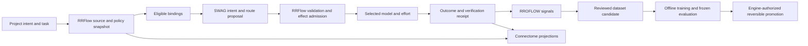

# ADR: Evidence-driven System One optimization

**Status:** Proposed architecture; offline evidence projection implemented.
**Date:** 2026-10-28.
**Deciders:** Product owner and the owning RRFlow/Connectome/RROFLOW maintainers.
This document records engineering analysis, not independent senior-engineer approval
or completion of the engine roadmap.

The [outcome research plan](outcome-research-plan.md) now makes the owner's five
milestones explicit and adds observed task/handoff supervision separately from
this document's supplied-score policy experiments. Its offline implementation
does not establish a completed UI workflow or a qualified custom router.

## Context

SWAG should interpret intent and propose bounded routes quickly. RRFlow owns
accepted plans, relevant source identities, authorization, budgets and effects.
Connectome presents engine-owned state. RROFLOW receives authorized observations
and supplies evidence for improvement. These are separate responsibilities in one
product experience; UI state or telemetry must not silently become execution authority.

Our original Qwen3-Coder BF16 endpoint matched 7/13 development cases, with five
eligibility violations. Faster serving alone would accelerate wrong decisions.
The existing supplied-score selector is also too narrow to establish intent
understanding or handoff quality. We need independent measurements for each task.

## Research evidence and limits

| Primary source | What it establishes | SWAG application |
|---|---|---|
| [Liquid RIPL announcement](https://www.liquid.ai/blog/low-latency) | Liquid reports low end-to-end latency for LFMs, enterprise GPU availability, and Shopify deployment examples. Comparisons involve particular models and workloads. | Study short-request serving and tail latency under load. RIPL access, Qwen support and GB10 suitability are not established here; it is not an installed Qwen accelerator. |
| [Liquid open d1](https://www.liquid.ai/blog/d1-open) and [d1-3B model card](https://huggingface.co/LiquidAI/d1-3B) | A decision-specialized model produces typed answers without autoregressive output generation. Liquid reports small-model decision benchmarks and emphasizes answer-order shuffling and fixing dataset shortcuts. | Add a separately pinned small decision-model comparator. Investigate classification/ranking heads and permutation tests; do not attribute vendor performance to SWAG. |
| [Liquid decision-model documentation](https://docs.liquid.ai/lfm/models/decision-models) | Choice, yes/no probability and ordered-score primitives; thresholds should be calibrated on the application’s own data. | Use explicit answer sets and measured abstention thresholds. Never treat a returned probability as calibrated confidence without our own reliability evaluation. |
| [RouteLLM](https://arxiv.org/abs/2406.18665) | Routers can learn a quality/cost trade-off from preference data. | Collect paired task outcomes and compare a simple learned router with the large-model baseline. Published savings are not a SWAG forecast. |
| [Arch-Router](https://arxiv.org/abs/2506.16655) | A compact model maps requests to domain/action preferences. | Represent user preferences independently from provider permissions and quality evidence; test newly added model bindings without making names training shortcuts. |

Source claims are external evidence. A pinned d1 checkpoint has now been loaded
and measured locally: 9/13 development cases, three policy violations, about 92 ms
warm median. RIPL has not been installed. See [retained experiments](experiment-evidence.md).
The d1 card specifies custom code and a distinct license;
review distribution terms before bundling.
Do not assume generic Hugging Face chat snippets implement its decision API.

## Decision

Keep the requested Qwen3 BF16 → custom BF16 → quantized-custom sequence. Add a
small decision-model/classifier comparison; model size is a hypothesis, not a
qualification criterion. Preserve the later from-scratch 14B research objective,
but estimate data, compute and training feasibility separately.

The proposed runtime path is:

When no binding is eligible, the engine should produce a typed unavailable or
abstention result without asking a model to grant permission. When scores fully
determine a choice, use deterministic selection as a baseline. Reserve learned
work for ambiguity, intent, predicted task suitability and calibrated escalation.
The engine revalidates at effect time because quotas, authorization and source
revisions can change after inference. An ordinary edit creates affected successor
work; it does not globally lock a project or grant stale permission.

## Experiments and acceptance

1. Separate intent classification, binding ranking, effort choice, abstention and
   handoff verification. A handoff binds objective, context/source references,
   expected artifact, permitted effects, deadline/budget and verification evidence.
2. Establish deterministic and small-classifier baselines. Compare original Qwen
   BF16, custom BF16 and its quantized export; evaluate a small d1-like model as a
   separate experiment, not as the quantized arm of Qwen.
3. Randomize candidate order, rename opaque binding IDs, vary irrelevant text and
   test unseen bindings. Include ambiguity, unavailable quotas, unsupported effort,
   injection and source changes. Keep project/time-separated acceptance cases unseen.
4. Record paired model/effort outcomes on comparable tasks. Subscription access,
   remaining quota, API cost and capability availability stay distinct. Start with
   Claude Fable/Sonnet/Opus and Codex; do not hardcode unmeasured strength rankings.
5. Measure end-to-end p50/p95/p99 under arrival-rate sweeps, queue time, timeout
   rate, throughput, input/output length and total memory. Compare runtimes with the
   same model and precision before attributing an improvement to the runtime.
6. Measure calibration and selective risk/coverage, per-family error counts and
   uncertainty. Include deterministic enforcement rejection rates separately from
   model correctness. Frozen quality margins must precede acceptance evaluation.

Runtime optimizations to test after correctness: bounded context, candidate-set
reduction, native constrained outputs where applicable, warm residency, explicit
cache budgeting, batching/scheduling, then quantization. A single-pass decision
head can avoid generation cost but does not remove input-processing or weight memory.

## Learning triggers and UI

Signals may propose work. Unsupervised triggers can nominate repeated-failure
clusters, distribution changes or uncertain examples for inspection; they do not
manufacture labels. Supervised triggers require observed outcomes, consent,
independent review, redaction and split admission. Neither automatically trains,
deploys or shares private context. Engine routines must bind limits, cooldowns,
deduplication, receipts and cancellation before these become executable triggers.

The TypeScript viewer implemented under `ui/` reads an offline, content-free
projection of retained evaluation evidence. It shows measured decisions, latency,
failure signals and proposed learning stages. It has no mutation or model controls.
The local RROFLOW-shaped export is one report event, not reconstructed inference
turns: zero tokens describe report generation only, not the earlier model calls.

Connectome's inspected Learning workspace currently marks learning controls as
unavailable. Its owning engine contract requires public-SDK projections. The
future panel must consume generated engine operations; do not import this sibling
Python checkout into RRFlow or use browser storage as a plan/promotion database.

## Integration packages and evidence

| Owning repository | Required bounded change | Acceptance evidence |
|---|---|---|
| RRFlow | Extend existing configuration/endpoint/model families and engine-owned learning routines; keep binding selection separate from recipe/branch/context proposals. | Exact candidate PR, CI, stale-source conflict/replan tests, real admission/execution/readback and rollback receipts. |
| Connectome | Add views to the existing project Learning/task-detail workspace using the matching generated SDK. | Separate UI PR, reviewed engine/SDK pin, actual session tests, restart/readback and visual checks. |
| RROFLOW | Accept/correlate versioned routing signals and outcomes with receipts and source/model/policy identities. | Authenticated ingest, retry/upsert, retrieve/correlate and content-retention tests. |
| SWAG offline research | Reviewed exports, reproducible comparisons, evidence projection and model packaging experiments. | Frozen protocols, retained raw evidence, source/artifact hashes and real hardware measurements. |

The boundary review used RRFlow local revision
`dd225072bcc639c89b0eef968625cc73303ea998`, its
`docs/reference/client/connectome.md`,
`docs/reference/inference/learning/controller-training.md`, Connectome's
`src/screens/connectome/pages/RuntimeConnection/workspace.tsx`, and RROFLOW
`crates/rroflow-core/src/record.rs` at
`e27920912a2c24a9c3adc5fc7546be9d14859a7c`. These are inspected local revisions,
not assertions about current remote main. Reconcile with owning PRs before changing
those repositories. This turn changes none of their source or roadmap status.

## Consequences and next actions

The design supports smaller specialized controllers and transparent feedback,
while requiring more careful dataset and protocol work than a single accuracy
score. Generalization, calibration and end-to-end reliability remain unproven.

- [x] Research primary sources and map existing owners.
- [x] Export actual local evidence and content-free signals; build and test a TypeScript viewer.
- [ ] Admit the first real task/outcome reviews and freeze acceptance thresholds.
- [x] Run a separately pinned small decision-model comparison; retain its failures.
- [x] Complete provisional custom BF16 training, fresh reload and development comparison: 15/21 intent tasks versus base 14/21; routing remains unqualified (7/13, five policy violations). See [experiment evidence](experiment-evidence.md).
- [ ] Land the owning engine, Connectome and RROFLOW integration PRs with real receipts.
- [ ] Qualify compression toward 29 GB total serving memory and package native/container delivery.
