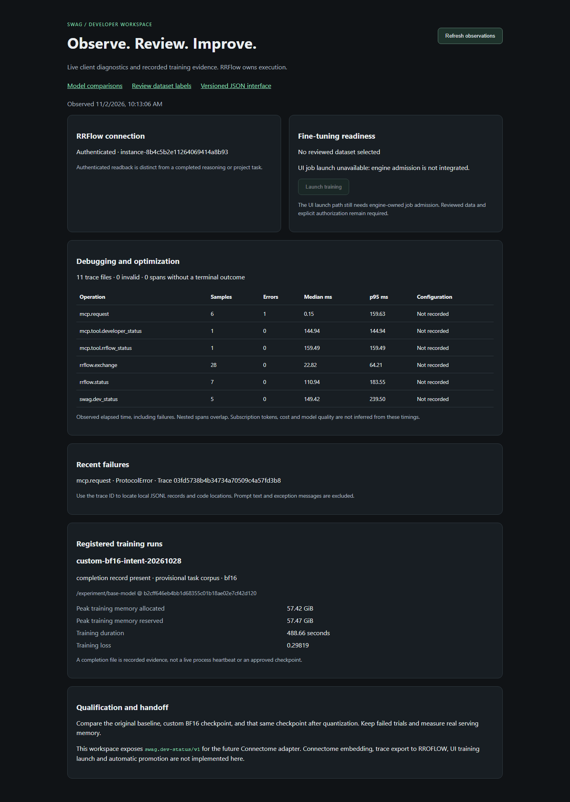

# SWAG developer workspace

The TypeScript workspace reads `swag.dev-status/v1` from
`GET /api/dev/status`. MCP exposes the same projection as `developer_status`.
Both call `tools/swag_dev_status.py`; Connectome can consume this versioned
contract through an adapter. No Connectome integration is claimed yet.

## Run locally

Install `requirements.txt` in a virtual environment, then set `SWAG_PYTHON` to
that interpreter in the process launching the UI. From `ui/`, run `npm ci`,
`npm run build`, then `npm run dev`. Open `http://127.0.0.1:8891/dev.html`.
`SWAG_UI_PORT` overrides the port. Host/origin checks restrict browser access;
the service binds loopback and provides no cross-origin API. Do not expose it
through a tunnel as an authenticated hosted service. `.env.example` documents
configuration; these processes do not automatically load an `.env` file.

The workspace shows actual operation timings/errors, an explicit engine state,
verified-export counts, and registered historical training artifacts. Unknown
measurements remain absent. Training memory is PyTorch allocated/reserved peak
memory from the recorded run, **not serving footprint**. A completion record
does not attest a live GPU, checkpoint contents, independent review or qualification.
Provisional task-corpus training stays visibly separate from reviewed routing data.
The [training evidence interface](training-evidence.md) adds recorded step/loss
history, interruption visibility and explicit manifest/verification receipts.
The [researched execution plan](training-control-plan.md) maps the remaining
engine, UI, qualification and delivery packages to their acceptance evidence.

## Configure the engine and artifacts

Set `SWAG_RRFLOW_CONNECTION_FILE` to a private JSON file:

```json
{
  "schemaVersion": 1,
  "baseUrl": "http://127.0.0.1:8080",
  "instanceId": "your-installed-instance",
  "credentialFile": "operator-credential.json"
}
```

Use the actual installed engine URL, identity and credential path. Relative
credential paths resolve beside this configuration file. Credentials stay on
disk and are never returned in status or traces. HTTPS is required outside
loopback; redirects are rejected. The probe discovers public operations,
creates an authenticated session, reads storage diagnostics and closes the
session. This proves connectivity only, not worker/model execution.

`SWAG_ADMITTED_DATASET_DIR` selects an existing reviewed export. File hashes,
counts, real-observation source kinds and chat/case consistency are checked;
this does not independently authenticate the reviewer. Empty splits are not ready.
`SWAG_TRAINING_RUNS_FILE` selects an explicit local registry:

```json
{"schemaVersion":1,"runs":[{"id":"my-recorded-run","directory":"C:/work/training/run"}]}
```

Register actual run directories. Missing files yield `unavailable`; a run config
alone yields `configured_outcome_unknown`. Metadata supplies model revision,
precision, dataset basis, recorded metrics and a content digest. No process
progress, deployment permission or model quality is inferred.

## Use with subscription clients

Codex and Claude clients retain their existing login/subscription authentication.
SWAG does not convert subscriptions into API keys or observe their quotas.
Register the bridge with absolute paths, using the verified local CLI syntax:

```powershell
codex mcp add swag -- C:/work/swag/.venv/Scripts/python.exe C:/work/swag/tools/swag_mcp_server.py
claude mcp add --scope user --transport stdio swag -- C:/work/swag/.venv/Scripts/python.exe C:/work/swag/tools/swag_mcp_server.py
```

Pass the optional configuration variables through the client's MCP environment
settings. Restart/reconnect the client and call `health`, `developer_status` or
`rrflow_status`. Registration is not evidence of an agent actually invoking a
tool. `decision_route` is a legacy policy preview: direct model-execution flags
are rejected on MCP. RRFlow must own execution admission and provider dispatch.

## Trace and optimization semantics

`SWAG_TRACE_DIR` defaults to `.swag/traces` in the checkout. Each request writes
an exclusive JSONL file with correlated nested span IDs, measured duration,
error class and SWAG code locations. MCP returns trace IDs on success and tool
failure. An optional `_meta.traceparent` propagates a caller's W3C trace ID;
RRFlow requests carry it plus engine request/operation IDs. This does not prove
the engine exported distributed spans. Prompts, credentials, payloads, URLs,
exception messages and stack locals are excluded from these new traces.
Older preview artifacts have separate content rules and may include intent.

Summaries distinguish completed, incomplete and invalid records; the UI shows
recent failures with trace IDs. Timings include failed requests. Nested spans
overlap and must not be summed. Configuration identity is unknown unless
explicitly recorded; endpoint timing is not a quality, token or cost metric.
Files are bounded individually, but total storage has no retention policy yet.
Manage retention locally; there is no automatic upload or RROFLOW trace exporter.

## Remaining implementation sequence

1. Define and implement engine-owned training-job admission with pinned model,
   reviewed dataset digest, trainer revision, parameters, resource limits and
   explicit operator authorization. Return a durable job ID, not a shell command.
2. Add engine progress, cancellation, failure/restart recovery and artifact
   verification. Connect UI launch/cancel controls only to those operations.
3. Run the same frozen acceptance protocol against the original baseline,
   custom BF16 checkpoint and that checkpoint after quantization. Record
   routing quality, policy violations, latency and measured serving memory.
4. Add Connectome's public-SDK adapter and correlated RROFLOW delivery with
   durable retry/readback. Review learning candidates before dataset admission;
   keep training and promotion separately authorized.

Acceptance requires real execution receipts and relevant merged PRs. The
disabled launch control is a visible dependency, not a completed fine-tuning UI.

The screenshot below captures the actual local developer workspace, including
historical BF16 training measurements and unavailable capabilities:


