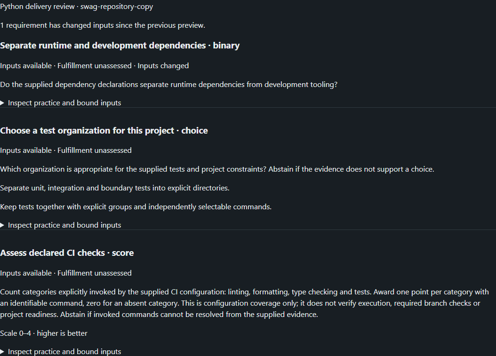

# Knowledge templates in the developer workspace

The local UI and MCP now share `swag.knowledge-preview/v1`. This read-only
adapter binds a shipped template to selected project files and actual source-linked
question-set entries. It implements choice, score and binary answer validation;
it does not call a model, execute work or maintain a fulfillment ledger.

## Bind a real project

Set `SWAG_KNOWLEDGE_BINDING_FILE` in the UI/MCP process environment to a private
JSON file. For this repository, a binding placed in `.swag/` can contain:

```json
{
  "schemaVersion": 1,
  "projectId": "swag",
  "repo": "..",
  "template": "python_delivery_review",
  "inputs": {
    "packaging": ["requirements.txt"],
    "tests": ["tests/test_swag_knowledge.py"],
    "ci": [".github/workflows/ci.yml"]
  }
}
```

These are explicitly selected inputs, not a claim of exhaustive project coverage.
Include referenced configuration/scripts needed to resolve the rubric. Paths use
forward slashes, stay under the selected project and cannot escape through symlinks.
Each read is bounded to 2 MB. Missing files or unbound slots remain `missing_inputs`;
invalid bindings produce an unavailable UI preview rather than fabricated data.

```powershell
python tools/swag_knowledge.py --binding .swag/knowledge-project.json
```

Use the repository virtual environment with `requirements.txt` installed. The UI
uses `SWAG_PYTHON` and the same binding, exposes `GET /api/dev/knowledge`, and shows
the template under **Project knowledge and templates** on `/dev.html`. Browser
requests cannot select a filesystem path. The API retains existing loopback,
host/origin and GET-only restrictions. MCP provides `knowledge_preview` with no
arguments; it returns the same projection under the same configuration.

## Source and decision identities

`config/knowledge/templates/` contains versioned JSON definitions. The included
Python delivery review has a binary dependency question, a choice of test
organization and an explicit 0–4 CI-configuration rubric. These are authored
template definitions, not observed answers, training examples or universal scores.
Add templates by naming real question-set/question IDs and declaring input slots
and mode-specific options, rubric or proposition. Generated question text still
follows its existing source/export workflow; this adapter does not modify it.

Each requirement retains source metadata, applicability and a digest of the selected
practice. Source freshness remains `not_reverified`. Input revisions bind project
identity, template identity, the requirement definition, its knowledge and selected
file bytes. File contents and absolute project paths are excluded from the preview.
This is a local observation, not an authenticated or atomic engine snapshot.

`validate_template_decision` takes `requirementId` and an `answer` matching
[`swag.decision-answer/v1`](../config/knowledge/decision_answer.schema.json).
The answer supplies the current `inputSha256`, mode, status (`answered` or
`abstained`), value and evidence-reference digests. References must resolve to the
selected practice or observed input files. Abstention uses a null value. Answered
binary values must be booleans, choices must be supplied option IDs, and scores
must be finite numbers within the template's scale. Missing inputs permit only
abstention. Validation rereads current inputs before accepting the output shape.

`contractValid` means structural validity only. `correctnessVerified` and
`executionAuthorized` remain false; fulfillment remains `unassessed`. No model
identity, calibration, successful test or deployment outcome is inferred.

## Ordinary edits and the remaining engine boundary

Changing a bound input invalidates only requirements using that input. Old answers
are rejected; refresh supplies new revisions immediately. Unrelated project files
do not lock the template. The UI compares consecutive previews and displays changed
requirements without storing a second authoritative plan or completion state.

The browser driver `ui/browser-tests/knowledge.spec.ts` copies actual repository
inputs into a disposable project, loads the UI/API, edits its dependency file,
refreshes, checks only one requirement changed, and confirms fulfillment stays
unassessed. It also checks read-only/origin controls and narrow-screen rendering.
This proves preview invalidation, not engine replanning or executed project effects.



Next integration: map the typed proposal and knowledge/template identities onto
RRFlow's public operation owner, retain source-bound execution/verification receipts,
then project fulfillment into Connectome. Discovery PR248 is merged; worker
publication and governed project-effect acceptance still require their owning
evidence. No direct endpoint invocation or local fulfillment mutation bypasses that
boundary. Full graph retrieval, custom knowledge-pack distribution, automatic
learning and post-deployment verification remain follow-on work.
