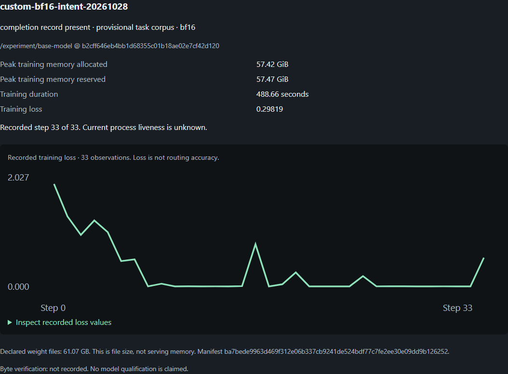

# Training observations and artifact verification

This implements the first SWAG adapter package in the
[researched training-control plan](training-control-plan.md). It adds evidence
and input checks; RRFlow's engine-owned job admission remains unimplemented.

## Inspect actual runs

Register a directory in `SWAG_TRAINING_RUNS_FILE` as described in the
[developer workspace](developer-workspace.md). The UI/MCP projection reads
`trainer_state.json` or the new attempt's `training-observations-*.jsonl`, displays
recorded optimizer steps and loss, and exposes an accessible values table.
It does not infer a running process from a recent timestamp or a completed job
from a full step count. Loss is not task/routing accuracy. Projection keeps at
most 200 metric records and reports omissions; incomplete JSONL tails retain
only complete observations and are marked explicitly.

The committed regression fixture is a reduced projection of the actual retained
2026-10-28 BF16 run: 33 steps and 37 metric records. Its source digest and
provisional label basis are recorded in the file. It is not newly fabricated
training data, independent review, or qualification evidence.

## Verify artifact bytes explicitly

```powershell
python tools/swag_training_artifacts.py --directory C:/work/checkpoint --manifest C:/work/checkpoint/artifact-manifest.json --max-bytes 80000000000 --receipt C:/work/evidence/verification.json
```

The operator chooses the paths and byte budget. The verifier streams declared
files, checks sizes/digests, rejects escaped paths and symlinks, detects file or
manifest changes, and refuses to overwrite a receipt. It never imports Torch,
loads pickle/tensors, or calls a model. The receipt covers **declared files only**;
it does not validate tensor semantics, attest hardware or prove model reload.

Optional registry fields `artifactManifest` and `artifactVerification` select
the manifest and a retained receipt. Relative paths resolve beside the registry.
The UI checks that the past receipt matches the current manifest, without
rehashing large weights on every refresh. Changed manifests mark the receipt
stale; changed weights require rerunning explicit verification. Declared weight
file size, training peak memory and serving footprint remain separate measures.

## New admitted training attempts

`swag_unsloth_train.py` continues to require independently reviewed real data,
an explicit seed and a fresh output directory. It now also requires an exact
40-character model revision. This pins Hub selection; a local directory still
requires separate byte verification and cannot be attested by a revision string.
Before GPU imports it consumes the verified train/development bytes into an
immutable process snapshot. A relevant input change rejects that attempt and
requires fresh admission; an unrelated source/document edit does not trap a project.

Actual Trainer callbacks emit the content-free
[`swag.training-observation/v1` schema](../config/training/training_observation.schema.json).
Only whitelisted numeric metrics, step counts, attempt identity and phase/error
class are recorded. Source digests for the observation helpers accompany the
trainer digest. `--observation-max-bytes` controls a 1 KiB–4 MB bound.

During the training loop, SIGINT/SIGTERM requests cooperative stop and checkpoint
save at an optimizer-step boundary. This is not immediate interruption during a
GPU kernel. Interrupted or short runs do not write completion metadata; a hard
kill may leave no terminal record. Unknown remains unknown. GPU behavior of this
new callback path still requires a real authorized run; CPU tests prove control
handling only. Distributed training is explicitly refused until qualified.

Full checkpoint resume is **not implemented by this package**. Retained Trainer
checkpoints include optimizer-capable state, but reusing them needs verified
input/runtime identity and the engine's uncertain-activity reconciliation. A
saved checkpoint or callback event is not permission to restart a job.

## BF16 export

The exporter requires `--model-id` and `--max-base-bytes`; there is no historical
model-name fallback. It verifies the base inventory and checks matching completed
Trainer state. An interruption record blocks export as a completed model. The
result records reviewed/provisional dataset lineage and stays unqualified until
fresh reload and frozen acceptance evaluation pass. This remains an explicit
offline CLI, not a UI execution endpoint.

## Remaining proof

Fresh Spark access, actual checkpoint rehash, callback stop/checkpoint behavior
on the pinned GPU stack, engine activity admission/recovery, UI launch/cancel,
Connectome integration and RROFLOW delivery remain separate acceptance work.
New training requires independently reviewed labels; the earlier provisional
experiment cannot satisfy that requirement.


